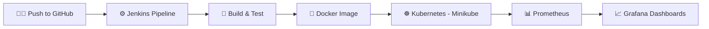

<div align="center">


# 🚀 DevOps × Cloud × Full-Stack Developer

[](https://git.io/typing-svg)


</div>

---

## 👋 About Me

> **"I build applications, then I build the pipeline, containers, and dashboards that keep them running."**

I'm a final-year **B.Tech Computer Science & Engineering** student at **Lovely Professional University** (2023 – 2027). I enjoy the full journey of a project: writing the app, automating its build and deployment, and monitoring it once it's live.

```yaml
name: Malla Bala Raju
education: B.Tech CSE, Lovely Professional University (2023 - 2027)
focus:
  - CI/CD pipeline automation
  - Containerization & orchestration
  - Full-stack web development
certified:
  - Oracle Cloud Infrastructure 2025 AI Foundations Associate
  - Oracle Data Platform 2025 Foundations Associate
currently:
  - Deepening Kubernetes and cloud skills
  - Building more production-style projects
looking_for: DevOps / Cloud / Full-Stack internships and fresher roles
```

---

## 🛠️ Tech Stack

**Languages**


**Frontend & Backend**


**DevOps & Cloud**


-E95420?style=for-the-badge&logo=ubuntu&logoColor=white)


**Databases & Monitoring**


**ML (Foundations)**


---

## 📌 Featured Projects

### 🛍️ [LuxeShop: Cloud Native DevOps E-Commerce Platform](https://github.com/MallaBalaRaju/LuxeShop)
*Apr 2026 · Solo project*

A MERN-style e-commerce app wrapped in a complete DevOps workflow.

- RESTful APIs for authentication, product management, and order processing (**Node.js, Express.js, MongoDB**)
- **Jenkins CI/CD pipeline** integrated with GitHub to automate build, test, and deploy
- Frontend, backend, and database containerized with **Docker & Docker Compose**
- Deployed on **Kubernetes (Minikube)** for scalable, self-healing orchestration
- **Prometheus + Grafana** dashboards for application health and infrastructure metrics



`Node.js` `Express.js` `MongoDB` `Docker` `Jenkins` `Kubernetes` `Prometheus` `Grafana`

---

### 🧾 [buyX: Premium E-Commerce Platform](https://github.com/MallaBalaRaju/buyX)
*Feb 2026 · Group project (team of 4)*

A full-stack marketplace supporting both customer and distributor operations.

- Responsive, mobile-first UI built with **React, Next.js, and Tailwind CSS**
- Backend services for authentication and product management using **Django, Python, and SQLite**
- Took part in testing, debugging, and feature validation

`Next.js` `React` `Django` `Python` `SQLite` `Tailwind CSS`

---

### 💧 Smart Resource Management Application
*Jun – Jul 2025 · Training project at Lovely Professional University (team of 4)*

A resource-conservation app for optimizing household energy and water use.

- Applied **Scikit-learn** to analyze appliance resource-usage patterns
- Flask web app with interactive dashboards for visualization and monitoring
- Contributed to backend, **MySQL** integration, data preprocessing, and testing

`Python` `Flask` `MySQL` `Scikit-learn`

---

## 🎓 Certifications

| Certification | Issuer | Date |
|---|---|---|
| Oracle Cloud Infrastructure 2025 Certified AI Foundations Associate | Oracle | Apr 2026 |
| Oracle Data Platform 2025 Certified Foundations Associate | Oracle | Apr 2026 |
| Full Stack Developer Course | Simplilearn | May 2026 |
| Cloud Computing | NPTEL | Apr 2025 |
| Introduction to Hardware and Operating Systems | Coursera | Sep 2024 |

---

## 🌱 Currently Focused On

| Area | What I'm working on |
|---|---|
| ☸️ **Kubernetes** | Going beyond Minikube toward real cloud-hosted clusters |
| 🔄 **CI/CD** | Automating more of the build, test, and deploy flow |
| ☁️ **Cloud** | Hands-on practice alongside my Oracle certifications |
| 🌐 **Full Stack** | Shipping polished apps with React, Next.js, and Node.js |

---

## 📊 GitHub Stats

<div align="center">


</div>

---

## 🌐 Connect With Me

<div align="center">

[](https://linkedin.com/in/malla-balaraju/)
[](mailto:mallabalaraju7@gmail.com)
[](https://github.com/MallaBalaRaju)

> 💼 **Open to:** DevOps, Cloud, and Full-Stack internships and fresher roles
>
> ⚡ **Philosophy:** *Build it, containerize it, automate it, monitor it.*


</div>
